# Kerygma Converter

Convertidor de video, audio y fotos de escritorio para **Mac y Windows**. Funciona 100 % offline: ffmpeg viene incluido dentro de la app y tus archivos nunca salen de tu equipo.

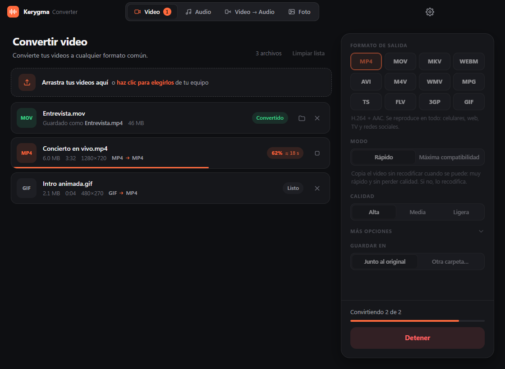

| Pestaña | Qué hace | Entradas | Salidas |
|---|---|---|---|
| **Video** | De un formato de video a otro | MOV, MP4, M4V, MKV, AVI, WEBM, WMV, FLV, MPG, TS, MTS, M2TS, 3GP, OGV, GIF | MP4, MOV, MKV, WEBM, AVI, M4V, WMV, MPG, TS, FLV, 3GP, GIF |
| **Audio** | De un formato de audio a otro | MP3, WAV, M4A, AAC, FLAC, OGG, OPUS, WMA, AIFF | MP3, M4A, AAC, WAV, FLAC, ALAC, AIFF, OGG, OPUS, WMA, AC3, M4R |
| **Video → Audio** | Extrae la pista de audio | Los mismos videos (salvo GIF) | Los mismos 12 formatos de audio |
| **Foto** | De un formato de imagen a otro | JPG, PNG, WEBP, BMP, TIFF, GIF, ICO | JPG, PNG, WEBP, AVIF, TIFF, BMP, GIF, ICO |

## Capturas

| Video | Audio |
|---|---|
|  | 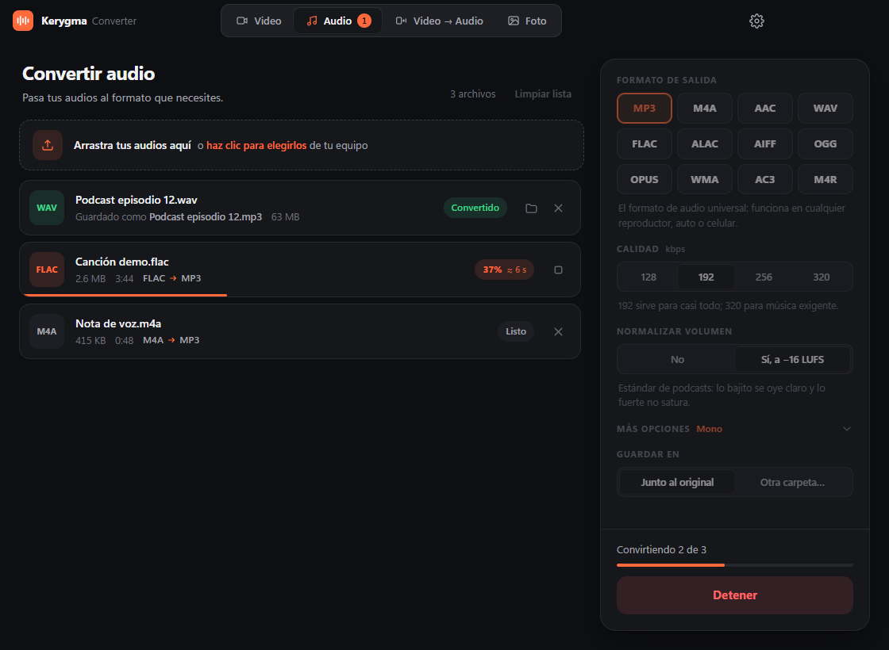 |
| **Video → Audio** | **Foto** |
| 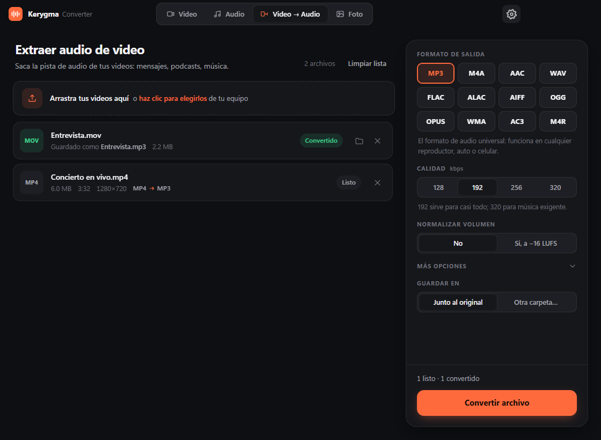 | 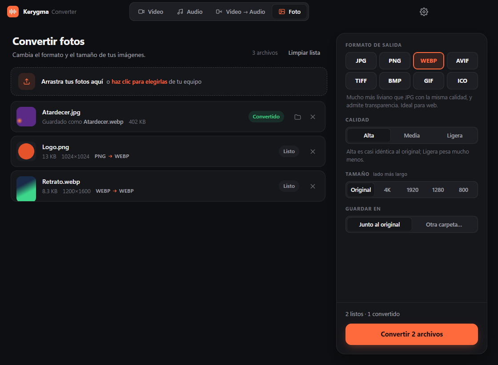 |

La app sigue el tema claro u oscuro del sistema:

| Tema claro | |
|---|---|
| 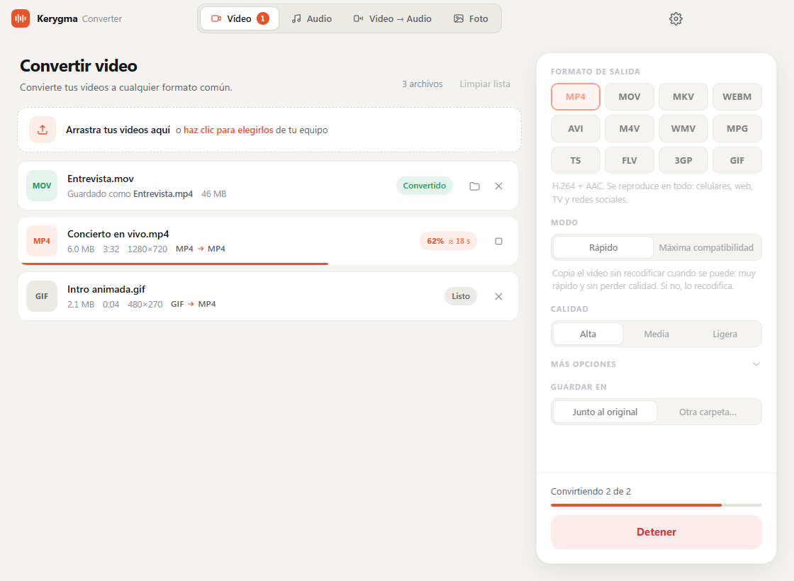 | 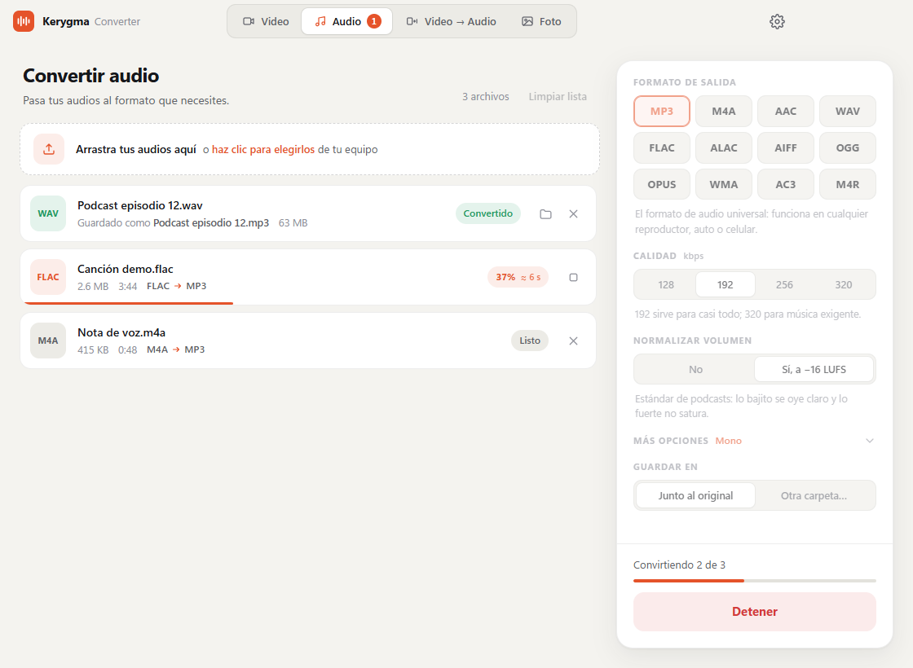 |
| 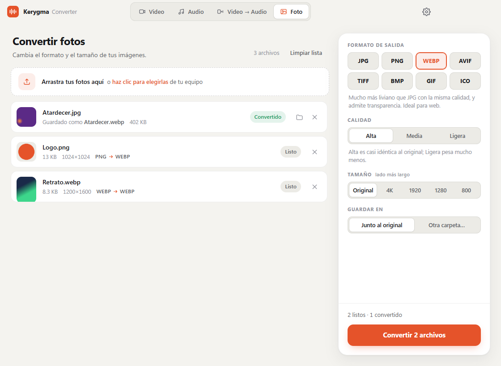 | 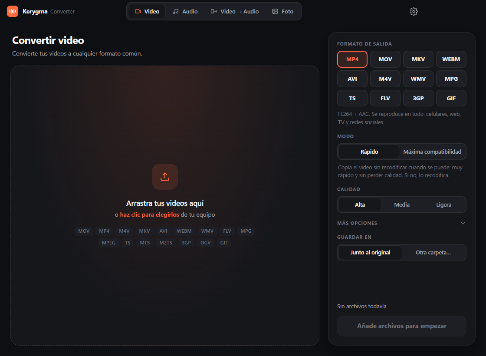 |

## Configuración

El engranaje de la barra superior (o `Ctrl/⌘ + ,`) abre la configuración. Los cambios se aplican al instante y se guardan para la próxima vez.

| Tema oscuro | Tema claro |
|---|---|
| 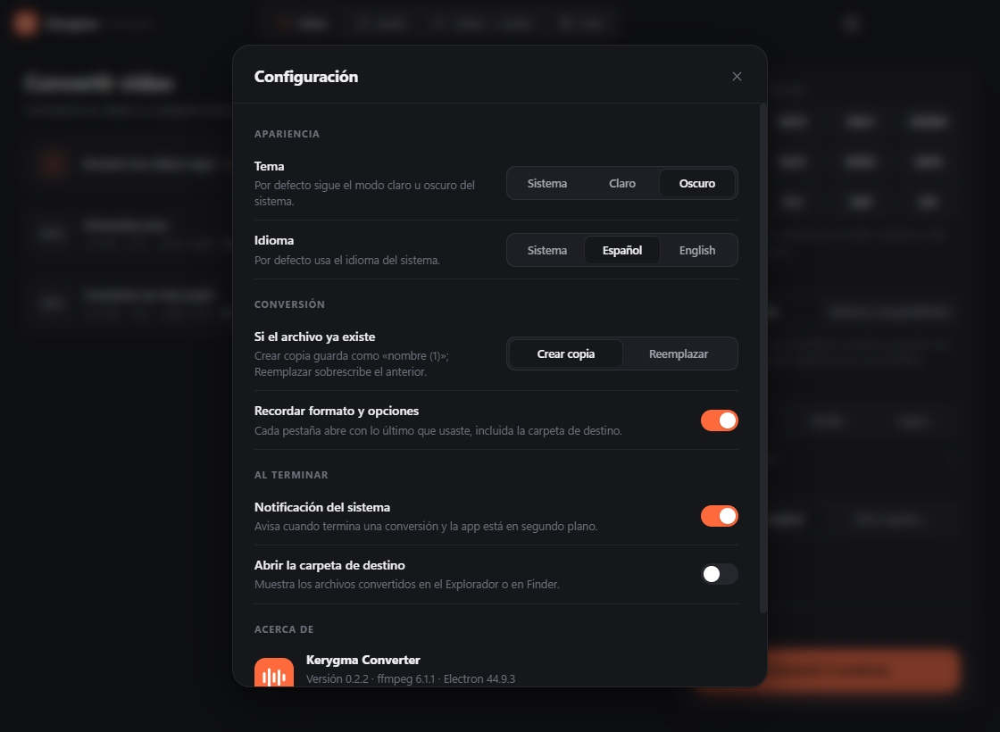 | 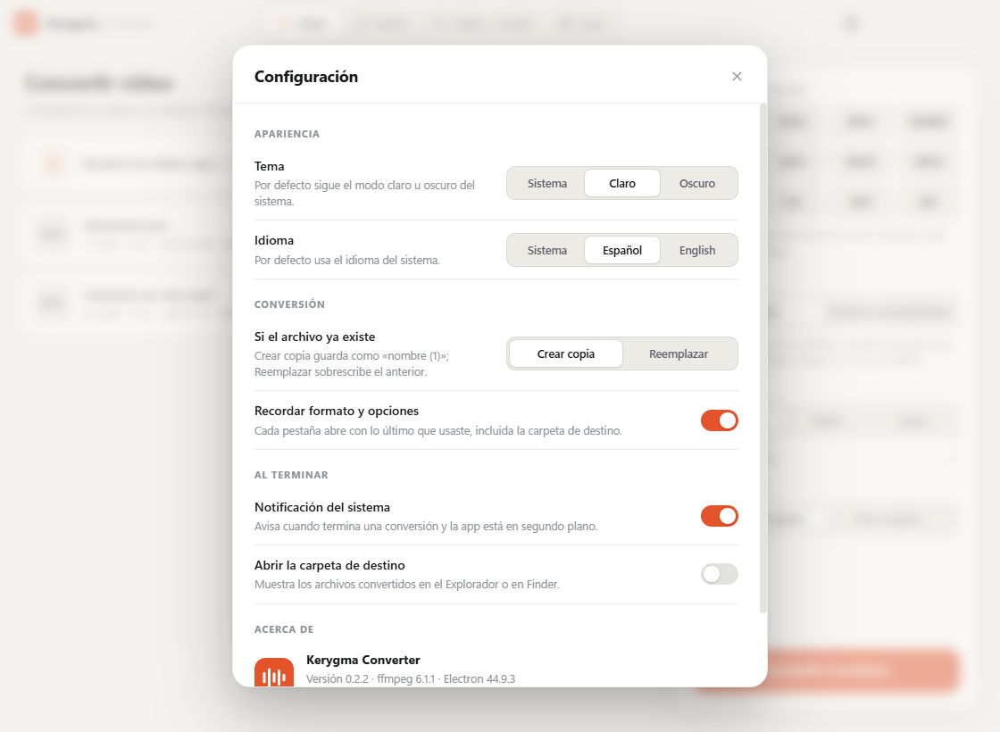 |

| Opción | Valores | Por defecto |
|---|---|---|
| **Tema** | Sistema, Claro, Oscuro | Sistema |
| **Idioma** | Sistema, Español, English | Sistema (español si Windows/macOS está en español; si no, inglés) |
| **Si el archivo ya existe** | Crear copia `nombre (1)` o Reemplazar | Crear copia |
| **Recordar formato y opciones** | Cada pestaña abre con lo último que usaste, incluida la carpeta de destino | Activado |
| **Notificación del sistema** | Aviso al terminar si la app está en segundo plano | Activado |
| **Abrir la carpeta de destino** | Muestra los archivos convertidos al terminar | Desactivado |

También muestra la versión de la app y de ffmpeg, un enlace al repositorio y **Restablecer configuración**.

Las preferencias se guardan en `settings.json`, dentro de la carpeta de datos de la app (`%APPDATA%\Kerygma Converter` en Windows, `~/Library/Application Support/Kerygma Converter` en Mac). Al convertir, la app escribe primero en un archivo temporal y lo renombra al terminar: con **Reemplazar**, si la conversión falla o se cancela, el archivo anterior queda intacto.

## Funciones

- Arrastra y suelta varios archivos a la vez (o `Ctrl/⌘ + O`).
- **Modo rápido** en video: copia la imagen y el audio sin recodificar cuando el formato de destino los admite (segundos, sin pérdida). Si no se puede, recodifica automáticamente solo lo necesario.
- **Máxima compatibilidad**: recodifica siempre al códec estándar de cada formato, con calidad configurable y resolución en *Más opciones*:

  | Formato | Video | Audio |
  |---|---|---|
  | MP4, MOV, M4V, MKV, TS, FLV, 3GP | H.264 | AAC |
  | WEBM | VP9 | Opus |
  | AVI | MPEG-4 (Xvid) | MP3 |
  | WMV | WMV2 | WMA |
  | MPG | MPEG-2 | MP2 |
  | GIF | Paleta optimizada, 10–20 fps | — |
- **Audio** (pestañas Audio y Video → Audio):
  - Calidad de 128 a 320 kbps en los formatos con pérdida; WAV, FLAC, ALAC y AIFF conservan toda la calidad.
  - **Normalizar volumen** a −16 LUFS, el estándar de podcasts y streaming: ideal para grabaciones con volumen desparejo.
  - En *Más opciones*: canales (estéreo o mono) y frecuencia (44.1 o 48 kHz). Los formatos con pérdida bajan automáticamente a 48 kHz el audio de mayor frecuencia (96 kHz de estudio, por ejemplo), porque no lo admiten.
  - **M4R** genera un tono de llamada para iPhone con los primeros 40 segundos.
- Elige la carpeta de destino: junto al original u otra carpeta.
- **Fotos**: calidad (alta, media o ligera) y tamaño máximo (4K, 1920, 1280 u 800 px por el lado más largo, sin agrandar las pequeñas). Respeta la orientación de las fotos de celular. JPG, AVIF y BMP no admiten transparencia, así que el fondo transparente pasa a blanco; PNG, WEBP, TIFF, GIF e ICO la conservan. ICO se reduce a 256 px como máximo. Por ahora no lee fotos HEIC de iPhone.
- Nunca sobrescribe: si el archivo ya existe, guarda como `nombre (1).mp4`.
- En español e inglés, con tema claro u oscuro (ver [Configuración](#configuración)).
- Atajos: `Ctrl/⌘ + 1…4` cambia de pestaña, `Ctrl/⌘ + O` abre archivos y `Ctrl/⌘ + ,` abre la configuración.

## Desarrollo

Requisitos: [Node.js](https://nodejs.org) 20 o superior.

```bash
npm install
npm start
```

## Generar instaladores

En tu propia máquina (genera para el sistema donde lo ejecutes):

```bash
npm run dist
```

Los archivos quedan en `dist/`:

| Archivo | Para quién |
|---|---|
| `Kerygma-Converter-<versión>-Windows-Instalador.exe` | Windows: se instala con acceso directo en el menú Inicio |
| `Kerygma-Converter-<versión>-Windows-Portable.exe` | Windows: se abre directo, sin instalar (ideal para una USB) |
| `Kerygma-Converter-<versión>-Mac-Apple-Silicon.dmg` | Mac con chip M1, M2, M3 o posterior |
| `Kerygma-Converter-<versión>-Mac-Intel.dmg` | Mac con procesador Intel |

Para obtener todos sin tener una Mac, actualiza `version` en `package.json`, y luego crea y sube un tag con esa versión:

```bash
git tag v0.2.2
git push origin v0.2.2
```

El workflow de [`.github/workflows/build.yml`](.github/workflows/build.yml) compila las cuatro versiones y crea una **Release** en GitHub donde cada instalador se descarga por separado. Si lanzas el workflow a mano desde **Actions**, cada versión queda como un artifact independiente.

El ícono se genera desde el logo: `build/icon.png` (Windows) y `build/icon-mac.png` (Mac, con el margen de los íconos de macOS).

> **Mac:** la app no está firmada con un certificado de Apple, así que la primera vez hay que abrirla con clic derecho → **Abrir**.
>
> **Windows:** tampoco está firmada, así que SmartScreen puede mostrar "Windows protegió su PC": haz clic en **Más información → Ejecutar de todas formas**.

### Instalador de Windows

El instalador está en español y usa los colores de la app: bienvenida y pantalla final en oscuro con el logo, cabeceras oscuras, registro de instalación oscuro y barra de progreso naranja. Los botones y campos siguen el estilo nativo de Windows.

| Bienvenida | Carpeta de destino |
|---|---|
| 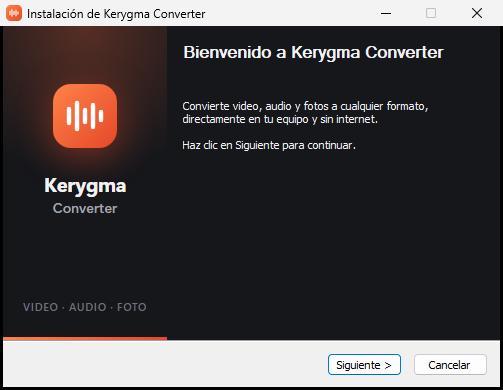 | 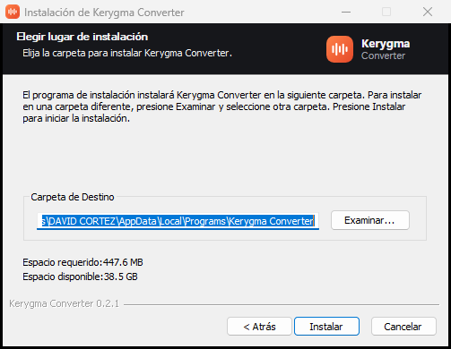 |
| **Instalando** | **Final** |
| 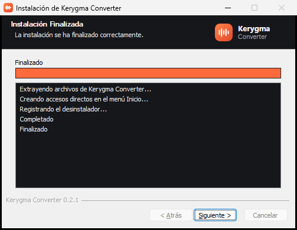 | 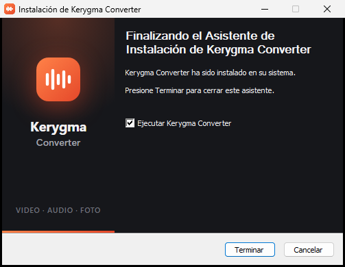 |

Crea la carpeta **Kerygma Converter** en el menú Inicio, con la app y un acceso directo **Desinstalar Kerygma Converter**.

**Para desinstalar** (cualquiera de estas opciones):

- Menú Inicio → Kerygma Converter → **Desinstalar Kerygma Converter**.
- **Configuración → Aplicaciones → Aplicaciones instaladas** → Kerygma Converter → Desinstalar.
- Ejecutar `Uninstall Kerygma Converter.exe` en la carpeta donde se instaló.

El desinstalador quita la app, sus accesos directos y sus datos. La versión **portable** no se instala: para quitarla basta con borrar el `.exe`.

La personalización está en [`build/installer.nsh`](build/installer.nsh); las imágenes, en `build/installerSidebar.bmp` (164×314) y `build/installerHeader.bmp` (150×57).

## Estructura

```
src/
  main/       proceso principal de Electron
    main.js     ventana, diálogos e IPC
    ffmpeg.js   análisis, conversión con progreso y cancelación
    presets.js  formatos y argumentos de ffmpeg
    settings.js preferencias guardadas en settings.json
  preload/    puente seguro entre la interfaz y el sistema
  renderer/   interfaz (HTML, CSS y JS sin dependencias)
    i18n.js     textos en español e inglés
    app.js      pestañas, lista de archivos y configuración
build/        ícono, imágenes y personalización del instalador
```

## Licencias

El código de la app es MIT. El binario de ffmpeg incluido (vía [`ffmpeg-static`](https://github.com/eugeneware/ffmpeg-static)) se distribuye bajo GPL; si distribuyes la app, incluye esa licencia.
